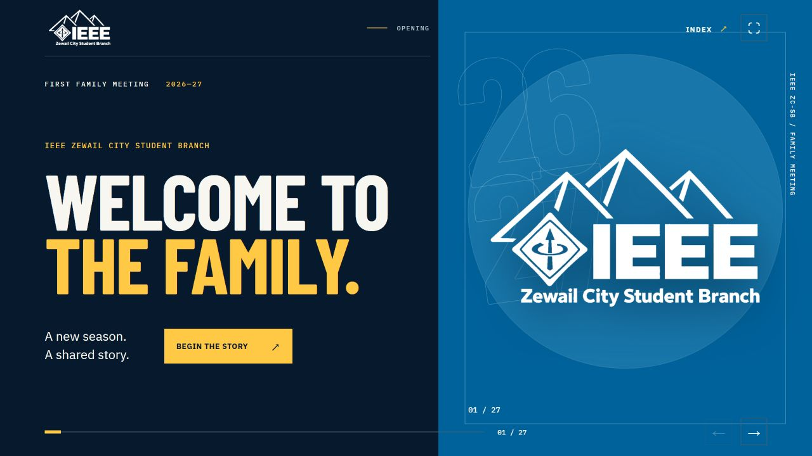

# IEEE ZC-SB · First Family Meeting 2026/27

An interactive, 27-scene website presentation for the IEEE Zewail City Student Branch family meeting.

**Live site:** https://eslammohamed202220-beep.github.io/ieee-zc-family-meeting/



The presentation follows the supplied kickoff PDF, with two additional scenes before the board introduction: a summary of what the team does and the team's film. It includes an animated IEEE logo transition, interactive board and committee profiles, a slide index, a discussion timer, and keyboard and touch navigation. The final scene composes supplied transparent portraits into a team image. Members without supplied photos appear by name without a substitute portrait.

## Presenting

- Use the on-screen arrows, **← / →**, **Page Up / Page Down**, or **Space** to navigate.
- Open **INDEX** or press **O** to jump to any scene.
- Press **F** for full screen and **Esc** to close an open profile or the index.
- Click a committee to see its leaders. Click a profile to enlarge it.
- On the film scene, press **Play the film**. Playback uses the browser's native video controls.

## Run locally

Requires Node.js 22 or newer.

```powershell
npm ci
npm run dev
```

Open the local URL printed by Vite. To check the production bundle, run `npm run build` and `npm run preview`.

## Project

The site is built with Vite, vanilla JavaScript, CSS, and GSAP. `src/content.js` contains the slide order, committee roster, and text. `src/presentation.js` builds the scenes and handles navigation. The transparent portraits, IEEE ZC-SB logo, and team film are in `public/assets`. GitHub Actions builds and publishes `dist` to GitHub Pages on pushes to `main`. The public site has no runtime account or API dependency.

The meeting content and media were supplied by the project owner. Public access to this repository does not grant reuse rights to the team portraits, logo, or film.
